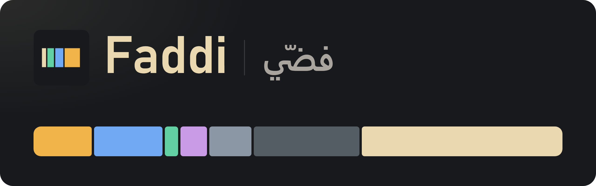

<div dir="rtl">

<p align="center">
  
</p>

<p align="center">
  <a href="README.md">English</a> &middot;
  <b>العربية</b> &middot;
  <a href="README.es.md">Español</a> &middot;
  <a href="README.fr.md">Français</a> &middot;
  <a href="README.pt.md">Português</a> &middot;
  <a href="README.ru.md">Русский</a> &middot;
  <a href="README.tr.md">Türkçe</a> &middot;
  <a href="README.zh.md">简体中文</a>
</p>

<p align="center">
  <b>اعرف ما الذي يلتهم مساحة قرصك، ونظّفه بأمان، وأبقِ الرام تحت السيطرة.</b><br>
  برنامج Windows مجاني ومفتوح المصدر. يقرأ القرص كله في نحو دقيقة، ويرتّب كل ما يجده حسب مدى أمان حذفه،
  ويفرّغ الذاكرة التي تحجزها البرامج وهي لا تستخدمها. ملف exe واحد صغير، ولا شيء يحتاج إلى تثبيت.
</p>

<p align="center">
  <a href="https://github.com/sox29-ui/Faddi/releases/latest"></a>
  <a href="https://github.com/sox29-ui/Faddi/releases"></a>
  <a href="LICENSE"></a>
  
  
  
  
</p>

<p align="center">
  <a href="#التثبيت">التثبيت</a> &middot;
  <a href="#المزايا">المزايا</a> &middot;
  <a href="#لقطات-الشاشة">لقطات الشاشة</a> &middot;
  <a href="#ما-ينظفه-faddi">ما ينظفه</a> &middot;
  <a href="#تحسين-الرام">تحسين الرام</a> &middot;
  <a href="#آمن-بالتصميم">آمن بالتصميم</a> &middot;
  <a href="#للمطورين">للمطورين</a> &middot;
  <a href="CONTRIBUTING.md">المساهمة</a>
</p>

<p align="center">
  
</p>

---

## ما هو Faddi؟

اسم Faddi (فضّي) معناه بالعامية: فرّغ المساحة. يريك البرنامج أين ذهبت مساحة قرصك بالضبط، ويساعدك على استعادتها دون أن يتعطل شيء. يقرأ القرص كله، ويقسّمه إلى ألعاب وبرامج، ومخلفات البرمجة، وكاش، وملفات قديمة، وWindows نفسه، ثم يخبرك ما هو كل عنصر وماذا يحدث لو حذفته.

- **اعرف أين ذهبت المساحة**: شريط واحد للقرص كله، وخريطة لكل مجلد، وأكبر الملفات، والملفات المكررة.
- **نظّف بأمان**: الكاش محدَّد مسبقاً، وكل ما عداه ينتظر قرارك، والملفات الشخصية تذهب إلى سلة المحذوفات.
- **أبقِ الرام تحت السيطرة**: فرّغ الذاكرة بنقرة واحدة أو تلقائياً، واعرف أي برنامج تسبب في قفزة مفاجئة.
- **تعرّف على جهازك**: المعالج والرام وكرت الشاشة والأقراص مع حالتها الصحية، والشبكة وبرامج بدء التشغيل، وكل واحد منها مشروح بكلمات بسيطة.

كل شيء يبقى على جهازك. لا يرسل Faddi أي شيء عبر الشبكة.

## التثبيت

### سطر واحد في PowerShell (الأسهل، وبلا شاشة تحذير)

اضغط زر «ابدأ»، واكتب `PowerShell`، ثم اضغط Enter، وبعدها الصق هذا السطر واضغط Enter:

<div dir="ltr">

```powershell
irm https://raw.githubusercontent.com/sox29-ui/Faddi/main/install.ps1 | iex
```

</div>

ينزّل أحدث إصدار من `Faddi.exe` إلى &lrm;`%LOCALAPPDATA%\Programs\Faddi`&lrm;، ويضيف Faddi إلى القائمة «ابدأ» وإلى سطح المكتب، ثم يفتحه. لتحديث البرنامج شغّل السطر نفسه مرة أخرى.

### أو تنزيل ملف exe

<p>
  <a href="https://github.com/sox29-ui/Faddi/releases/latest/download/Faddi.exe"></a>
</p>

1. نزّل **Faddi.exe** من [أحدث إصدار](https://github.com/sox29-ui/Faddi/releases/latest). وهو ملف واحد بحجم 66 MB تقريباً، وفيه كل شيء، فلا حاجة إلى تثبيت.
2. انقر عليه نقراً مزدوجاً. يبدأ الفحص فوراً: خمسة ملايين ملف على قرص NVMe SSD تستغرق من 45 إلى 90 ثانية، ويمتلئ شريط القرص أثناء القراءة.

   قد يعرض Windows الرسالة **«قام Windows بحماية الكمبيوتر»** لأن ملف exe جديد وغير موقَّع رقمياً. انقر **«مزيد من المعلومات»**، ثم **«تشغيل على أي حال»**. سطر PowerShell أعلاه يتجنب هذه الشاشة.
3. اختياري: اضغط **«شغّل كمسؤول»** أسفل الشريط الجانبي. بصلاحيات المسؤول يستطيع Faddi قراءة المجلدات المحمية، وعرض حرارة القرص وعمره، وتنظيف مخلفات Windows نفسه، وتفريغ كاش Standby.

> يستخدم Faddi بيئة Microsoft Edge WebView2 Runtime، وهي مدمجة في Windows 11 وموجودة بالفعل على كل أجهزة Windows 10 تقريباً. وإذا لم تكن موجودة فسيخبرك Faddi بذلك.<br>
> لإزالة Faddi أوقف الخيار **«يشتغل مع ويندوز جنب الساعة»** في «الرام والأداء»، ثم احذف `Faddi.exe` (أو &lrm;`%LOCALAPPDATA%\Programs\Faddi`&lrm;) واختصاراته ومجلد &lrm;`%LOCALAPPDATA%\Faddi`&lrm;.

## المزايا

| الميزة | ما الذي يمكنك فعله |
|---|---|
|  **القرص بنظرة واحدة** | شريط واحد يقسّم القرص إلى ألعاب وبرامج، ومخلفات البرمجة، وكاش وملفات مؤقتة، وأشياء قديمة وكبيرة، وWindows، وباقي الملفات. |
|  **خريطة المساحة** | كل مجلد مربع يتناسب حجمه مع المساحة التي يشغلها، ويدل لونه على المدة التي مرت منذ تغيّر أي شيء فيه. انقر على مربع لتدخل إليه. |
|  **تنظيف حسب درجة الأمان** | الكاش والملفات المؤقتة تأتي محدَّدة مسبقاً، أما مخلفات البرمجة والألعاب الكبيرة والمجلدات التي لم يتغير فيها شيء منذ 6 أشهر فتنتظر قرارك. كل عنصر يوضح ما هو وماذا يحدث لو حذفته. |
|  **مخلفات البرمجة** | `node_modules` بجانب ملف lockfile، وبيئات Python (venv)، ومجلد `Library` في Unity، ومجلد `DerivedDataCache` في Unreal، ومجلدا `bin` و`obj` في &lrm;.NET، ومخرجات البناء في Gradle وFlutter وRust، وكاش npm وpip وuv وNuGet وGradle وHugging Face. |
|  **أكبر الملفات وأنواعها** | أكبر الملفات على القرص، وأنواع الملفات التي تشغل أكبر مساحة. |
|  **الملفات المكررة** | نسخ تُكتشف بمقارنة المحتوى وليس الأسماء. وتُستبعد الارتباطات الثابتة (hard links) التي تبدو كنسخ فقط. |
|  **البرامج المثبتة** | كل برنامج بحجمه الحقيقي على القرص، وزر يشغّل برنامج إلغاء التثبيت الخاص به. |
|  **مُحسّن الرام** | يفرّغ الذاكرة بنقرة واحدة، أو من تلقاء نفسه عندما يتجاوز الاستخدام حداً معيناً أو كل بضع دقائق، وفقط عندما يكون المعالج غير مشغول. [المزيد أدناه](#تحسين-الرام). |
|  **مراقب الرام** | يقيس كل ثانيتين ويسجّل القفزات المفاجئة مع البرامج التي تقف وراءها، إضافة إلى نصائح مثل وضع حدّ لذاكرة WSL، أو تعريف يسرّب الذاكرة، أو عملية Gradle daemon تُركت تعمل. |
|  **معلومات الجهاز** | المعالج وشرائح الرام وكرت الشاشة مع حرارته المباشرة في كروت NVIDIA، والأقراص مع الصحة والحرارة والاستهلاك، والشبكة والشاشات والبطارية وبرامج بدء التشغيل، ومع كل واحد منها شرح قصير. |
|  **بجانب الساعة** | عند إغلاق النافذة يبقى Faddi يعمل بجانب الساعة ويراقب الرام. ويمكن أن يبدأ مع Windows. |
|  **ثماني لغات** | English والعربية وEspañol وFrançais وPortuguês وРусский وTürkçe و简体中文، مع عرض العربية من اليمين إلى اليسار. يفتح بلغة Windows لديك. |

## لقطات الشاشة

<table>
  <tr>
    <td width="50%"><p align="center">الرئيسية: القرص كله في شريط واحد</p></td>
    <td width="50%"><p align="center">خريطة المساحة، ملوّنة حسب العمر</p></td>
  </tr>
  <tr>
    <td><p align="center">التنظيف، مرتّباً حسب درجة الأمان</p></td>
    <td><p align="center">مُحسّن الرام</p></td>
  </tr>
  <tr>
    <td><p align="center">معلومات الجهاز، مباشرةً</p></td>
    <td><p align="center">بالإنجليزية</p></td>
  </tr>
  <tr>
    <td><p align="center">简体中文</p></td>
    <td><p align="center">Русский</p></td>
  </tr>
</table>

## ما ينظفه Faddi

يقع كل ما يجده Faddi في إحدى المجموعات الخمس التالية، بالألوان نفسها المستخدمة في شريط القرص.

| المجموعة | ما فيها | ماذا يحدث عند تنظيفها |
|---|---|---|
|  **«تنظيف آمن»** | ملفات مؤقتة أقدم من أسبوع، وكاش المتصفحات وكاش كرت الشاشة (Shaders)، وغيرها من الكاش الذي تعيد البرامج بناءه | تُحذف. تعيد البرامج إنشاءها عند الحاجة. محدَّدة مسبقاً. |
|  **«مخلفات البرمجة»** | `node_modules` وبيئات venv ومجلدات البناء وكاش الحزم | تُحذف. تعود بأمر واحد مثل `npm install`. |
|  **«ألعاب وبرامج»** | الألعاب والبرامج الكبيرة المثبتة | تُزال ببرنامج إلغاء التثبيت الخاص بها، أو من إعدادات Windows. |
|  **«أشياء قديمة وكبيرة»** | مجلدات لم تتغير منذ 6 أشهر، وتنزيلات وفيديوهات قديمة | تُنقل إلى سلة المحذوفات، لتتمكن من استعادتها. |
|  **«ويندوز والنظام»** | pagefile وملف السبات وWinSxS ونقاط الاستعادة | لا تتغير إلا عبر أدوات Windows نفسها، مع توضيح معنى كل تغيير. |

## تحسين الرام

افتحه من **«الرام والأداء»**، أو من زر **«حسّن»** في الشريط الجانبي، أو من الأيقونة بجانب الساعة. يطلب من كل برنامج أن يُرجع الذاكرة التي يحجزها دون أن يستخدمها؛ ولا يأخذ البرنامج بعد ذلك إلا ما يحتاجه فعلاً، فتتوفر مساحة أكبر للعبة أو للبرنامج الثقيل.

| الإعداد | ماذا يفعل |
|---|---|
|  **«حسّن الرام الحين»** | يفرّغ الذاكرة فوراً ويعرض مقدار ما عاد منها. |
| **«لما يوصل استخدام الرام»** | يعمل من تلقاء نفسه عندما يتجاوز الاستخدام الحد الذي تختاره (من 70 إلى 95%، والافتراضي 85%)، مرة واحدة كل دقيقتين على الأكثر. |
| **«كل»** | يعمل بمؤقّت: كل 3 أو 5 أو 10 أو 30 أو 60 دقيقة. |
| **«بس لما يكون المعالج فاضي»** | تنتظر التشغيلات التلقائية حتى يصبح استخدام المعالج أقل من 30%، فلا تؤثر أبداً على لعبة تعمل. مفعّل افتراضياً. |
| **«تفريغ الرام من البرامج»** | يفرّغ مجموعة العمل (working set) لكل برنامج: صفحات الذاكرة التي يحجزها دون أن يستخدمها تعود إلى Windows. مفعّل افتراضياً. |
| **«تفريغ كاش ويندوز (Standby)»** | بصلاحيات المسؤول يفرّغ أيضاً كاش الملفات المستخدمة مؤخراً الذي يحتفظ به Windows في الرام. |
| **«مسح الحافظة»** | يمسح آخر ما نسخته، وقد يكون صورة كبيرة. |
| **«نبّهني بعد كل تحسين تلقائي»** | يعرض إشعاراً صغيراً بعد كل تشغيل تلقائي. |
|  **«لما أقفل النافذة، يبقى شغّال جنب الساعة»** | عند إغلاق النافذة يبقى Faddi بجانب الساعة، ويواصل مراقبة الرام وتشغيل المُحسّن. مفعّل افتراضياً. |
| **«يشتغل مع ويندوز جنب الساعة»** | يبدأ بجانب الساعة عند تسجيل الدخول. |

> تمتلئ الذاكرة المحرَّرة جزئياً من جديد عندما تعود البرامج إلى استخدامها، وهذا متوقع. يدير Windows الرام جيداً بنفسه، لذلك يفيد المُحسّن أكثر قبل تشغيل لعبة أو برنامج ثقيل مباشرة، أو بعد أن يكون شيء ما قد استحوذ على الذاكرة.

## آمن بالتصميم

- لا يُحذف أي شيء حتى تضغط **«نظّف المحدد»** وتؤكد. تذهب الملفات الشخصية (المجلدات القديمة والتنزيلات والفيديوهات) إلى سلة المحذوفات، ويحذّرك Windows قبل حذف أي شيء أكبر من أن تتسع له السلة.
- لا يتبع أبداً الوصلات (junctions) ولا الروابط الرمزية (symlinks)، فلا يمكن أن يصل تنظيف `node_modules` إلى مجلد مرتبط في مكان آخر.
- مجلدات Windows وProgram Files وProgramData\Microsoft، ومجلد كل مستخدم (بما فيه سطح المكتب والمستندات ومجلدات AppData)، كلها محظورة على التنظيف، وتُحلّ الأسماء المختصرة مثل `C:\PROGRA~1` قبل الفحص.
- يترك تنظيف الملفات المؤقتة كل ما تغيّر خلال آخر 7 أيام، ويتخطى الملفات التي يستخدمها برنامج قيد التشغيل. ولا يمسّ كاش مرفقات Outlook.
- ملفات النظام (pagefile وملف السبات وWinSxS ونقاط الاستعادة) لا تتغير إلا عبر أدوات Windows نفسها.
- لا يمكن إغلاق عمليات Windows الأساسية من صفحة «الرام والأداء».

## المتطلبات

- **Windows 10 أو 11، بنظام 64 بت.**
- **Microsoft Edge WebView2 Runtime**: مدمج في Windows 11 وموجود بالفعل على كل أجهزة Windows 10 تقريباً.
- **صلاحيات المسؤول**: اختيارية. كل شيء يعمل بدونها، وبعض الإضافات فقط تحتاج إليها.
- **كرت شاشة NVIDIA**: اختياري، لعرض حرارة كرت الشاشة ومروحته واستهلاكه للطاقة مباشرة.

## للمطورين

يتطلب [&lrm;.NET 8 SDK](https://dotnet.microsoft.com/download/dotnet/8.0) ونظام Windows.

<div dir="ltr">

```bash
git clone https://github.com/sox29-ui/Faddi.git
cd Faddi
dotnet run --project Faddi           # تشغيل البرنامج
dotnet run --project Faddi.Check     # فحوصات ذاتية: الماسح وقواعد التنظيف وحارس الحذف، على مجلدات مؤقتة
node tools/i18n-check.mjs            # كل لغة فيها كل النصوص، مع مواضع الاستبدال {0} الخاصة بها
```

</div>

لبناء ملف `Faddi.exe` الواحد الذي تُوزَّع به الإصدارات:

<div dir="ltr">

```bash
dotnet publish Faddi -c Release -r win-x64 --self-contained true -p:PublishSingleFile=true -p:IncludeNativeLibrariesForSelfExtract=true -p:EnableCompressionInSingleFile=true -p:DebugType=none -o publish
```

</div>

### هيكل المشروع

<div dir="ltr">

```text
Faddi/
  Faddi/                  البرنامج
    Program.cs            النافذة وأيقونة جنب الساعة ونسخة واحدة فقط من البرنامج والجسر الذي تتحدث عبره الصفحة
    Scanner.cs            فحص متوازٍ للقرص كله بالأحجام الحقيقية على القرص
    Cleanup.cs            قواعد التنظيف والحارس الذي يقرر ما يجوز حذفه أصلاً
    Dupes.cs              كاشف المكررات: تجزئة عينة من الملف أولاً ثم تجزئة SHA-256 كاملة
    Optimizer.cs          مُحسّن الرام
    Watcher.cs            أخذ عينات من المعالج والرام وكرت الشاشة والقرص والشبكة وسجل قفزات الرام
    SysInfo.cs            معلومات الجهاز من nvidia-smi وWMI والسجل
    Settings.cs, I18n.cs  الإعدادات والترجمات
    index.html            الواجهة كلها في صفحة واحدة
    lang/                 ملف JSON لكل لغة
  Faddi.Check/            الفحوصات الذاتية
  tools/i18n-check.mjs    أداة فحص الترجمات
  docs/                   الشعار والأيقونات ولقطات الشاشة لهذا الملف
```

</div>

### التقنيات المستخدمة

تطبيق WinForms على &lrm;.NET 8 يستضيف صفحة WebView2، بلا خادم ويب وبلا شبكة. يتعامل الفحص والمُحسّن والمراقب مع Windows مباشرة: `FindFirstFileExW` للفحص، و`EmptyWorkingSet` و`NtSetSystemInformation` للذاكرة، وعدّادات الأداء PDH للأرقام الحية، وWMI للأجهزة. الواجهة ملف HTML واحد بلا أي إطار عمل.

### إضافة لغة

العربية مكتوبة مباشرة في الكود، وكل لغة أخرى هي ملف واحد في `Faddi/lang`. انسخ `en.json` باسم رمز لغتك (مثل `de.json`)، وترجم القيم، واجعل قيمة &lrm;`"@name"`&lrm; اسم اللغة بلغتها هي، ثم شغّل `node tools/i18n-check.mjs` حتى لا يبلغ عن أي نقص أو خلل. تظهر اللغة الجديدة في قائمة اختيار اللغة أسفل الشريط الجانبي.

## بياناتك

- الإعدادات في &lrm;`%LOCALAPPDATA%\Faddi\settings.json`&lrm;، وسجل قفزات الرام في `spikes.json` بجانبه.
- لا يرفع Faddi أي شيء، وليس فيه حسابات ولا إعلانات ولا جمع لبيانات الاستخدام.

## المساهمة

نرحّب بالمشكلات (Issues) وطلبات الدمج (Pull requests)، وبخاصة اللغات الجديدة وقواعد التنظيف للأدوات التي لا يعرفها Faddi بعد. ابدأ بقراءة [دليل المساهمة](CONTRIBUTING.md)، ونرجو الالتزام [بمدونة قواعد السلوك](CODE_OF_CONDUCT.md).

هل وجدت مشكلة أمنية، مثل طريقة تجعل Faddi يحذف شيئاً لا ينبغي له حذفه؟ أبلغ عنها بشكل خاص كما هو موضح في [SECURITY.md](SECURITY.md).

## الترخيص

يُصدَر Faddi بموجب [رخصة MIT](LICENSE). وتحتفظ المكتبات المرفقة به برخصها الخاصة، المذكورة في [THIRD-PARTY-NOTICES.md](THIRD-PARTY-NOTICES.md).

</div>
