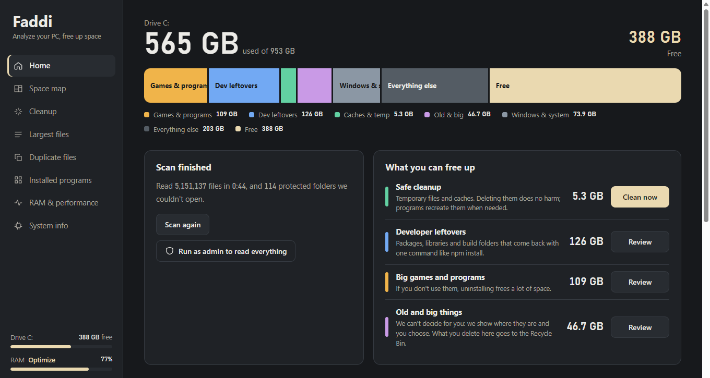
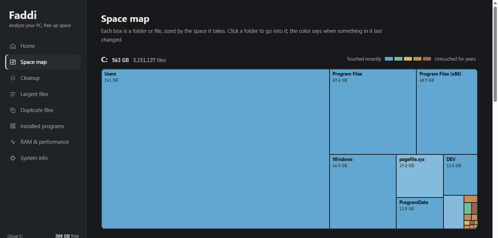
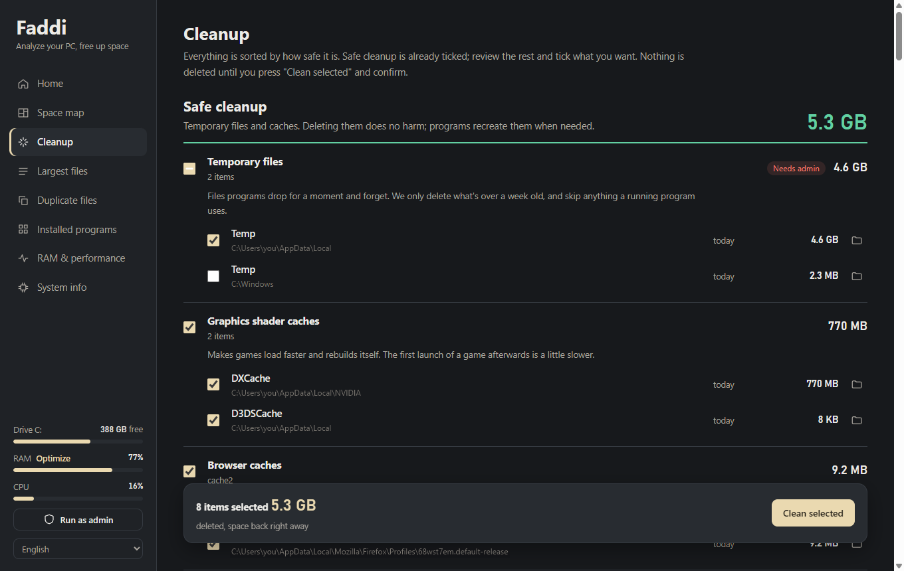
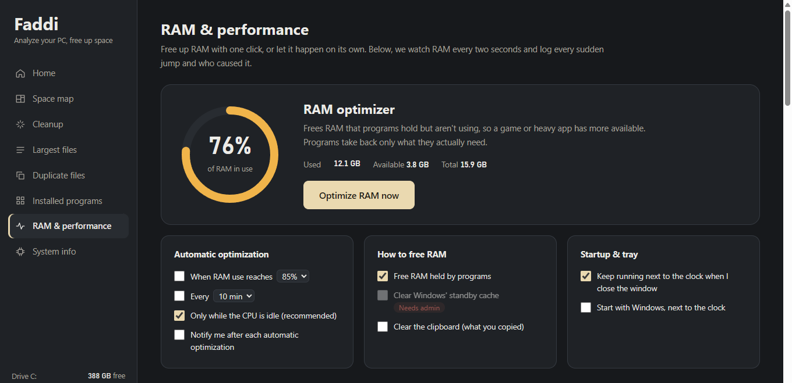
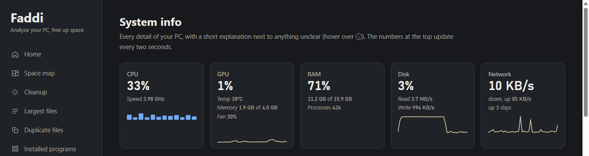
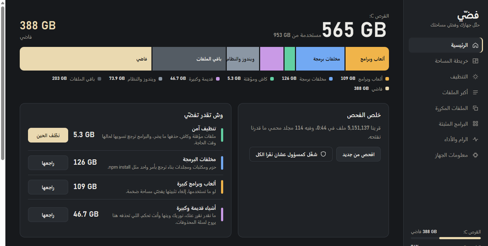
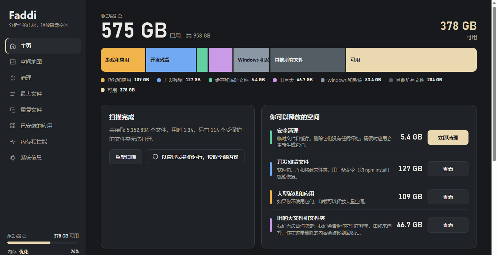
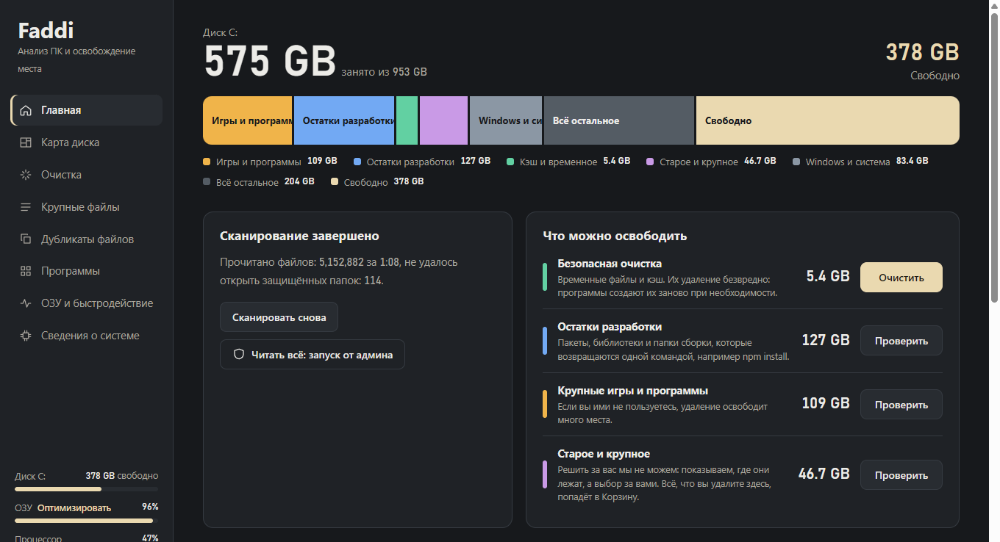
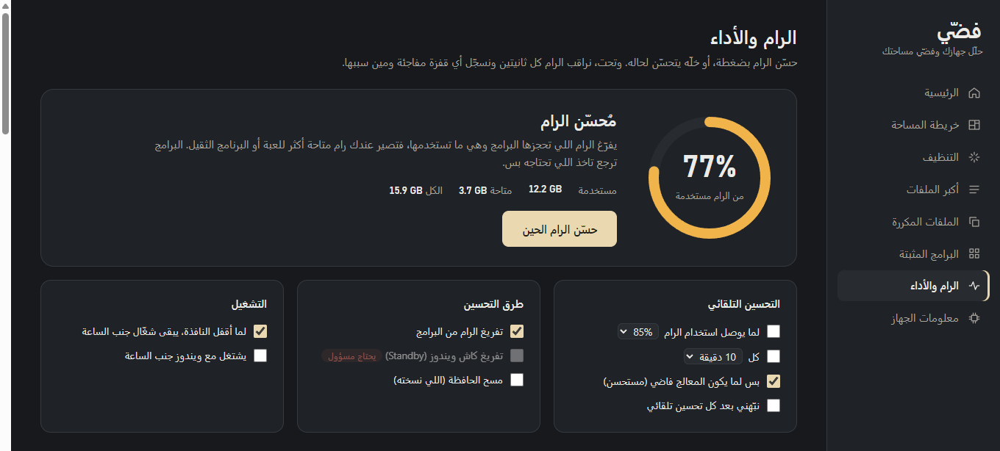

<p align="center">
  
</p>

<h1 align="center">Faddi · فضّي</h1>

<p align="center">
  <b>Find what's eating your disk, clean it safely, and keep your RAM in check.</b><br>
  A free Windows app that reads your whole drive in about a minute, sorts everything it finds by how safe it is to delete,<br>
  and frees the memory programs hold but aren't using. One small exe, nothing to install, in eight languages.
</p>

<p align="center">
  <a href="https://github.com/sox29-ui/Faddi/releases/latest"></a>
  <a href="https://github.com/sox29-ui/Faddi/releases"></a>
  <a href="LICENSE"></a>
  
  
  
  
</p>

<p align="center">
  <a href="#download">Download</a> &middot;
  <a href="#features">Features</a> &middot;
  <a href="#screenshots">Screenshots</a> &middot;
  <a href="#what-faddi-cleans">What it cleans</a> &middot;
  <a href="#the-ram-optimizer">RAM optimizer</a> &middot;
  <a href="#safe-by-design">Safe by design</a> &middot;
  <a href="#for-developers">For developers</a> &middot;
  <a href="#العربية">العربية</a>
</p>

<p align="center">
  
</p>

---

## What is Faddi?

Faddi (فضّي, Arabic for "free it up") shows you exactly where your disk space went and helps you get it back without breaking anything. It reads the whole drive, splits it into games and programs, developer leftovers, caches, old files and Windows itself, and tells you what each thing is and what happens if you delete it.

- **See where the space went**: one strip for the whole disk, a map of every folder, the largest files and the duplicates.
- **Clean it safely**: caches come pre-selected, everything else waits for you, and personal files go to the Recycle Bin.
- **Keep RAM in check**: free memory with one click or automatically, and see which program caused a sudden jump.
- **Know your PC**: CPU, RAM, GPU, disks with their health, network and startup apps, each explained in plain words.

Everything stays on your PC. Faddi sends nothing over the network.

## Download

<p>
  <a href="https://github.com/sox29-ui/Faddi/releases/latest/download/Faddi.exe"></a>
</p>

1. Download **Faddi.exe** from the [latest release](https://github.com/sox29-ui/Faddi/releases/latest). It's one file of about 66 MB with everything inside, so there is nothing to install.
2. Double-click it. The scan starts right away: five million files on an NVMe SSD take 45 to 90 seconds, and the disk strip fills in while it reads.

   Windows may show **"Windows protected your PC"** because the exe is new and not code-signed. Click **More info**, then **Run anyway**.
3. Optional: press **Run as admin** at the bottom of the sidebar. As admin Faddi can read protected folders, show disk temperature and wear, clean Windows' own leftovers and clear the standby cache.

> Faddi uses the Microsoft Edge WebView2 Runtime, which comes with Windows 11 and is already on almost every Windows 10 PC. If it's missing, Faddi tells you.<br>
> To remove Faddi, turn off **Start with Windows** in RAM & performance, then delete `Faddi.exe` and the `%LOCALAPPDATA%\Faddi` folder.

## Features

| Feature | What you can do |
|---|---|
|  **Disk at a glance** | One strip splits the drive into games and programs, developer leftovers, caches and temp, old and big things, Windows, and everything else. |
|  **Space map** | Every folder as a box sized by the space it takes, colored by how long since anything in it changed. Click a box to go inside. |
|  **Cleanup by safety** | Caches and temp files come pre-selected; developer junk, big games and folders untouched for 6 months wait for you. Every item says what it is and what happens if you delete it. |
|  **Developer junk** | `node_modules` next to a lockfile, Python venvs, Unity `Library`, Unreal `DerivedDataCache`, .NET `bin`/`obj`, Gradle, Flutter and Rust build output, and the npm, pip, uv, NuGet, Gradle and Hugging Face caches. |
|  **Largest files and types** | The biggest files on the drive, and which kinds of files take the most room. |
|  **Duplicate files** | Copies found by comparing content, not names. Hard links, which only look like copies, are left out. |
|  **Installed programs** | Every program with its real size on disk, and a button that runs its own uninstaller. |
|  **RAM optimizer** | Frees memory on a click, or on its own when usage passes a limit or every few minutes, only while the CPU is idle. [More below](#the-ram-optimizer). |
|  **RAM monitor** | Samples every 2 seconds and logs sudden jumps with the programs behind them, plus tips such as a WSL limit, a leaking driver or a Gradle daemon left running. |
|  **System info** | CPU, RAM sticks, GPU with live temperature on NVIDIA, disks with health, temperature and wear, network, displays, battery and startup apps, each with a short explanation. |
|  **Next to the clock** | Closing the window leaves Faddi in the tray, watching RAM. It can start with Windows. |
|  **Eight languages** | English, العربية, Español, Français, Português, Русский, Türkçe and 简体中文, right to left for Arabic. It opens in your Windows language. |

## Screenshots

<table>
  <tr>
    <td width="50%"><p align="center">Home: the whole disk in one strip</p></td>
    <td width="50%"><p align="center">Space map, colored by age</p></td>
  </tr>
  <tr>
    <td><p align="center">Cleanup, sorted by how safe it is</p></td>
    <td><p align="center">RAM optimizer</p></td>
  </tr>
  <tr>
    <td><p align="center">System info, live</p></td>
    <td><p align="center">العربية, right to left</p></td>
  </tr>
  <tr>
    <td><p align="center">简体中文</p></td>
    <td><p align="center">Русский</p></td>
  </tr>
</table>

## What Faddi cleans

Everything Faddi finds lands in one of five groups, in the same colors as the disk strip.

| Group | What's in it | What happens when you clean it |
|---|---|---|
|  **Safe cleanup** | Temp files older than a week, browser and graphics shader caches, and other caches programs rebuild | Deleted. Programs recreate them when needed. Pre-selected. |
|  **Developer leftovers** | `node_modules`, venvs, build folders and package caches | Deleted. They come back with one command, like `npm install`. |
|  **Games and programs** | Big installed games and apps | Removed with their own uninstaller, or from Windows Settings. |
|  **Old and big things** | Folders untouched for 6 months, old downloads and videos | Moved to the Recycle Bin, so you can restore them. |
|  **Windows and system** | Pagefile, hibernation file, WinSxS, restore points | Changed only through Windows' own tools, with what each change means. |

## The RAM optimizer

Open it from **RAM & performance**, the **Optimize** button in the sidebar, or the tray icon. It asks every program to hand back the memory it holds but isn't using; programs take back only what they really need, so a game or a heavy app gets more room.

| Setting | What it does |
|---|---|
|  **Optimize now** | Frees memory right away and shows how much came back. |
| **When RAM use reaches** | Runs on its own when usage passes the limit you pick (50 to 95%, 85% by default), at most once every 2 minutes. |
| **Every** | Runs on a timer: every 3, 5, 10, 30 or 60 minutes. |
| **Only while the CPU is idle** | Automatic runs wait until the processor is under 30%, so they never cut into a game. On by default. |
| **Free memory programs hold** | Empties every program's working set: the pages it holds but isn't using go back to Windows. On by default. |
| **Clear Windows' standby cache** | As admin, also empties the cache of recently used files that Windows keeps in RAM. |
| **Clear the clipboard** | Empties what you copied last, which can be a large image. |
| **Notify** | Shows a small notification after each automatic run. |
|  **Keep running next to the clock** | Closing the window leaves Faddi in the tray, still watching RAM and running the optimizer. On by default. |
| **Start with Windows** | Starts in the tray when you sign in. |

> Freed memory partly fills back up as programs touch it again; that's expected. Windows manages RAM well on its own, so the optimizer helps most right before a game or a heavy app, or after something has been hogging memory.

## Safe by design

- Nothing is deleted until you press **Clean selected** and confirm. Personal files (old folders, downloads, videos) go to the Recycle Bin, and Windows warns before anything too big for the bin.
- It never follows junctions or symlinks, so cleaning `node_modules` can't reach a linked folder somewhere else.
- Windows, Program Files, ProgramData\Microsoft, every user profile and its Desktop, Documents and AppData folders are walled off, and short names like `C:\PROGRA~1` are resolved before checking.
- Temp keeps anything changed in the last 7 days, and skips files a running program is using. Outlook's attachment cache is left alone.
- System files (pagefile, hibernation file, WinSxS, restore points) are only changed through Windows' own tools.
- Core Windows processes can't be closed from the RAM page.

## Requirements

- **Windows 10 or 11, 64-bit.**
- **Microsoft Edge WebView2 Runtime**: built into Windows 11 and already on almost every Windows 10 PC.
- **Admin rights**: optional. Everything works without them; a few extras need them.
- **NVIDIA GPU**: optional, for live GPU temperature, fan and power.

## For developers

Needs the [.NET 8 SDK](https://dotnet.microsoft.com/download/dotnet/8.0) and Windows.

```bash
git clone https://github.com/sox29-ui/Faddi.git
cd Faddi
dotnet run --project Faddi           # run the app
dotnet run --project Faddi.Check     # self-checks: scanner, cleanup rules and the delete guard, on throwaway folders
node tools/i18n-check.mjs            # every language has every string, with its {0} placeholders
```

Build the single `Faddi.exe` the releases ship:

```bash
dotnet publish Faddi -c Release -r win-x64 --self-contained true -p:PublishSingleFile=true -p:IncludeNativeLibrariesForSelfExtract=true -p:EnableCompressionInSingleFile=true -p:DebugType=none -o publish
```

### Project structure

```text
Faddi/
  Faddi/                  the app
    Program.cs            window, tray icon, single instance, and the bridge the page talks to
    Scanner.cs            parallel whole-drive scan with real sizes on disk
    Cleanup.cs            cleanup rules, and the guard that decides what may ever be deleted
    Dupes.cs              duplicate finder: sampled hash first, then full SHA-256
    Optimizer.cs          RAM optimizer
    Watcher.cs            CPU, RAM, GPU, disk and network sampling, and the RAM jump log
    SysInfo.cs            system info from WMI, the registry and nvidia-smi
    Settings.cs, I18n.cs  settings and translations
    index.html            the whole interface, one page
    lang/                 one JSON file per language
  Faddi.Check/            self-checks
  tools/i18n-check.mjs    translation checker
  docs/                   logo, icons and screenshots for this README
```

### Tech stack

.NET 8 WinForms hosting a WebView2 page, with no web server and no network. The scan, the optimizer and the monitor talk to Windows directly: `FindFirstFileExW` for the scan, `EmptyWorkingSet` and `NtSetSystemInformation` for memory, PDH performance counters for live numbers, and WMI for hardware. The interface is one HTML file with no framework.

### Add a language

Arabic is written straight in the code; every other language is one file in `Faddi/lang`. Copy `en.json` to your language code (for example `de.json`), translate the values, set `"@name"` to the language's own name, and run `node tools/i18n-check.mjs` until it reports nothing missing or broken. The new language shows up in the picker at the bottom of the sidebar.

## Your data

- Settings live in `%LOCALAPPDATA%\Faddi\settings.json` and the RAM jump log in `spikes.json` next to it.
- Faddi never uploads anything, and has no accounts, ads or telemetry.

## Contributing

Issues and pull requests are welcome, especially new languages and cleanup rules for tools Faddi doesn't know yet. Please run the self-checks before sending a change to the cleanup rules.

## License

Faddi is released under the [MIT License](LICENSE).

---

<div dir="rtl">

## العربية

<p align="center">
  <b>اعرف وش ماكل مساحة جهازك، ونظّفها بأمان، وخلّ الرام تحت السيطرة.</b><br>
  برنامج مجاني لويندوز، ملف واحد بدون تثبيت، وبثمان لغات منها العربي والإنجليزي.
</p>

<p align="center">
  <a href="https://github.com/sox29-ui/Faddi/releases/latest/download/Faddi.exe"></a>
</p>


### وش يسوي

- **يفحص القرص كامل في حوالي دقيقة**، حتى لو فيه ملايين الملفات، ويوريك وين راحت المساحة في شريط واحد: ألعاب وبرامج، مخلفات برمجة، كاش، أشياء قديمة، ويندوز، والباقي.
- **خريطة المساحة**: كل مجلد مربع على قد حجمه، ولونه يقول متى آخر مرة انلمس.
- **تنظيف مرتب حسب الأمان**: الكاش والملفات المؤقتة محددة جاهز، والباقي أنت تقرر فيه. جنب كل عنصر مكتوب وش هو ووش يصير لو حذفته.
- **يعرف مخلفات البرمجة**: `node_modules` وبيئات بايثون وكاش npm وpip وGradle وUnity وUnreal وغيرها.
- **أكبر الملفات وأنواعها**، و**الملفات المكررة** (يقارن المحتوى مو الأسماء)، و**البرامج المثبتة** بحجمها الحقيقي.
- **مُحسّن الرام**: يفرّغ الرام اللي تحجزها البرامج وهي ما تستخدمها، بضغطة أو تلقائياً لما توصل الرام نسبة تحددها أو كل كم دقيقة، وبس لما المعالج فاضي.
- **مراقبة الرام**: يسجّل أي قفزة مفاجئة ومين سببها، ويعطيك نصايح.
- **معلومات الجهاز** كاملة مع شرح بسيط لكل شي.
- **يشتغل جنب الساعة**: إذا سكّرت النافذة يكمل يراقب الرام، ويقدر يشتغل مع ويندوز.



### التحميل

1. نزّل `Faddi.exe` من [آخر إصدار](https://github.com/sox29-ui/Faddi/releases/latest). يشتغل على ويندوز 10 و11 (64-bit) بدون تثبيت.
2. افتحه، والفحص يبدأ على طول.
3. لو طلع تحذير SmartScreen لأن البرنامج ما عليه توقيع رقمي، اضغط **More info** ثم **Run anyway**.
4. اختياري: اضغط **شغّل كمسؤول** تحت في القائمة عشان يقرأ المجلدات المحمية ويوريك حرارة القرص وعمره ويفضّي كاش ويندوز.

### آمن

- ما ينحذف شي إلا لما تضغط «نظّف المحدد» وتأكد، وملفاتك الشخصية تروح لسلة المحذوفات.
- ما يلحق الاختصارات والروابط (junctions)، وما يلمس مجلدات ويندوز والبرامج ومجلدات المستخدمين الأساسية.
- ملفات النظام (pagefile والسبات ونقاط الاستعادة) ما تتغير إلا بأدوات ويندوز نفسها.
- كل شي يبقى في جهازك، والبرنامج ما يرسل أي شي للإنترنت.

### الرخصة

[MIT](LICENSE)

</div>
